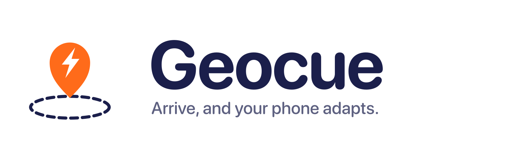
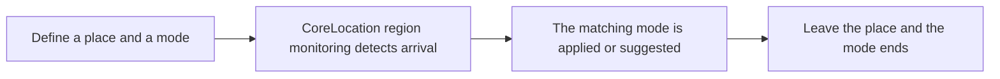

<div align="center">
  <picture>
    <source media="(prefers-color-scheme: dark)" srcset="branding/geocue-wordmark-on-dark.png">
    
  </picture>

  <p><strong>Arrive, and your phone adapts.</strong></p>

     
</div>

> **Status: in design.** Geocue is a fully briefed and branded product concept. The plan, scope and open questions are documented; the app has not been built yet.

## The idea

Your phone changes mode based on where you are: at the gym it shows your workout, at the office it quiets social distractions, at home after 9pm it winds down.

- **For:** People who want their phone to fit the place they are in without fiddling with settings.
- **Outcome:** Cross a place boundary and the phone is already set up for it.

## How it will work



## Planned features

- Place-based modes (gym, office, home-evening and more)
- Geofence boundaries stored only on the device
- Built around what iOS actually allows: Focus Filters (App Intents), Shortcuts automations, geofence notifications, widgets, Live Activities
- Honest about platform limits: third-party apps cannot silence other apps or switch Focus on their own

## Tech plan

| Layer | Choice |
|---|---|
| Language / UI | Swift, SwiftUI (iOS 17+) |
| Location | CoreLocation region monitoring |
| Integration | App Intents, Focus Filters, Shortcuts |
| Storage | Local, on-device |
| Backend | None |

## Privacy by design

Place boundaries are stored on the device only.

## Open decisions

Tracked openly in [`docs/PROJECT_BRIEF.md`](docs/PROJECT_BRIEF.md). A few of the big ones:

- PLATFORM LIMIT (verify against current Apple documentation before designing): iOS does not let a third-party app silence or block other apps, or switch the system Focus on its own. The mechanisms that appear to be available are Focus Filters (App Intents), user-installed Shortcuts location automations, geofence-triggered local notifications, widgets and Live Activities. Which of these make a worthwhile v1?
- Background region monitoring needs "Always" location access, which App Review scrutinizes. Is the value worth it?
- How many modes and places in v1.
- Pricing model.

## Brand

| | Name | Hex | Role |
|---|---|---|---|
|  | Cue Orange | `#FF6B1A` | Icon field, accent, key actions |
|  | White | `#FFFFFF` | Pin, light surfaces |
|  | Midnight | `#1B1F4B` | Geofence ring, text, dark surfaces |
|  | Peach | `#FF9A5C` | Ring and accents on dark |

**Mark.** A location pin with a lightning-bolt cutout over a dashed midnight geofence ring: arrive somewhere, trigger the change.

**Voice.** Quiet, confident, low-drama. Describe what the phone will do, in the present tense, without promising what iOS does not allow.

Full logo set (mark, wordmark, app icon in light and dark) and the brand guide are in [`branding/`](branding/BRAND_GUIDE.md).

## Repository contents

```
docs/PROJECT_BRIEF.md   Confirmed requirements, assumptions, open questions, scope
branding/               Logo files and BRAND_GUIDE.md
```

## License

Proprietary. Shared publicly for portfolio and demonstration purposes only. See [LICENSE](LICENSE).

---

<div align="center">

Built by [Aquila Digital LLC](https://github.com/Steven6Brown) · *Per Aspera Ad Astra*

</div>
